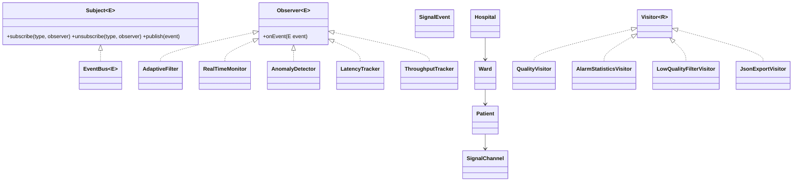

# Adaptive Biomedical Signal Processing

Қарапайым Java 17 оқу жобасы. Жүйе ойдан жасалған ECG/PPG/EEG сигналдарын өңдейді.
Бұл жоба медициналық диагностикаға арналмаған және нақты пациент деректерін қолданбайды.

## Жобаны іске қосу

1. Java 17 және Maven орнат.
2. Осы папкада терминал аш.
3. `mvn test` командасын орында.
4. `mvn package` командасымен жобаны жина.
5. Бағдарламаны IDE-ден `edu.example.biomed.app.Main` класындағы `main` әдісін іске қосып көр.

## Қалай жұмыс істейді?

- **Observer:** сигнал көзі оқиға жариялайды; тіркелген тыңдаушылар оны қабылдайды.
- **AdaptiveFilter:** жүктеме/кідіріс жоғары болса, өңдеу терезесінің өлшемін азайтады. Ол өзі де оқиға жариялап, агрегатор ретінде жұмыс істейді.
- **Visitor + Composite:** `Hospital → Ward → Patient → Channel/Device` ағашына есептеу, сүзгілеу және JSON шығару операциялары орындалады.
- **Concurrency:** `ExecutorService` арқылы бірнеше producer сигнал жібереді.
- **Өлшеу:** бағдарлама throughput (samples/second) және latency (milliseconds) көрсетеді.

## Құрылым

```text
src/main/java/edu/example/biomed/
  observer/   — Observer интерфейстері, оқиғалар және EventBus
  signal/     — сигнал көздері мен тыңдаушылар
  visitor/    — ағаш элементтері және Visitor операциялары
  app/        — бағдарламаны іске қосу
src/test/java/edu/example/biomed/
  — JUnit 5 тесттері
```

## Дизайн шешімдері

1. **Push тәсілі:** оқиға деректері тыңдаушыға бірден беріледі. Тыңдаушы дерек көзінен қайта сұрамайды.
2. **Thread safety:** тіркеу тізімі `ConcurrentHashMap` және `CopyOnWriteArrayList` арқылы қорғалған. Бүкіл Subject бір үлкен lock-пен жабылмайды.
3. **Traversal:** ағашты аралау Visitor кластарында орындалады. Әр жаңа Visitor өз операциясын орындай алады.
4. **Элементтер:** Hospital/Ward/Patient және жапырақ элементтері тек деректерін сақтайды; есептеу логикасы Visitor-ларда.
5. **Ескерту:** sampling rate пен терезе өлшемі бұл оқу жобасында жеңілдетілген модель ретінде көрсетілген.

## Қарапайым UML (Mermaid)



## Екі commit туралы талап

Тапсырмада екі бөлек commit талап етіледі. Репозиторийде жасағанда:
- 1-commit: жаңа Visitor қосып, Element кластарын өзгертпе.
- 2-commit: жаңа Element түрін қосып, қажет Visitor-ларды жаңарт.
Әр commit-та өзгерген файлдарды README-ге нақты жаз.

## Өнімділік тәжірибесі

`Main` бағдарламасы 1, 2 және 4 producer thread үшін throughput пен latency өлшейді. Нәтижелер компьютерге байланысты өзгеруі мүмкін; оларды алдын ала дайын сан ретінде қарастырма.
